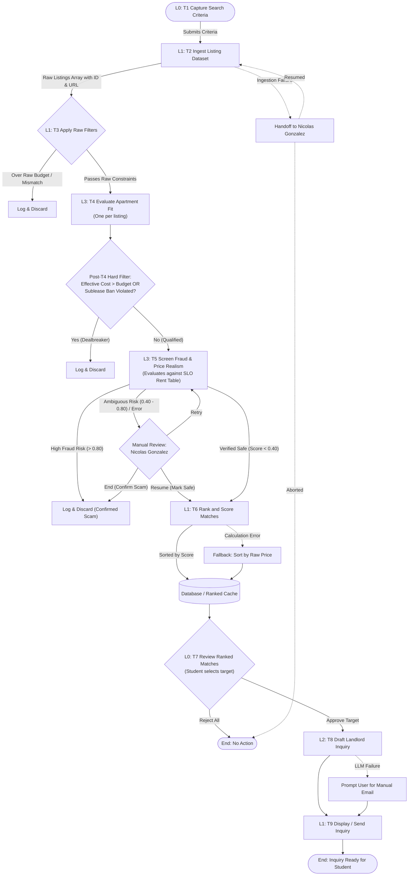

# Workflow of Tasks

## 1. Workflow Goal
This workflow supports the goal in my completed [team charter](https://github.com/nickiee-g/BUS4498_Team_Build/blob/main/README.md): to reduce the time and effort for Cal Poly students and local renters to find a qualifying off-campus rental in San Luis Obispo, while guaranteeing the system never recommends properties exceeding the maximum effective monthly budget or violating strict lease dealbreakers, and ensuring every recommendation includes a direct link to the listing.

## 2. Workflow Trigger
User submits weighted apartment search criteria (target commute, max budget, bedroom/bathroom count, and strict lease dealbreakers like sublease requirement) via the Capture Search Criteria step.

## 3. Completion Condition at Runtime
The workflow ends successfully when a qualified, scam-verified apartment match is reviewed by the user, and a personalized landlord inquiry draft is generated and presented in the dashboard for user approval.

## 4. General Workflow
1. **Capture Search Criteria (L0 - Trigger):** The student inputs explicit search constraints via the UI form.
2. **Ingest Listing Dataset (L1 - Code):** Automated script retrieves rental listings (from local curated CSV/JSON) and assigns each a stable `listing_id` and `listing_url` that persist through all downstream tasks.
3. **Apply Raw Filters (L1 - Code):** Strict deterministic if/else logic filters out listings that violate basic constraints (e.g., asking rent exceeds raw budget, or bedroom count does not match).
4. **Evaluate Apartment Fit (L3 - Agent per listing):** For each candidate listing, an agent extracts hidden amenities, fees (parking, utilities), detects lease restrictions (sublease clauses, pet policies), and looks up commute travel time to Cal Poly campus.
   - **Post-T4 Rule-Based Hard Filter:** A deterministic code check immediately discards any listing where `effective_monthly_cost > max_budget` or where a strict dealbreaker (e.g., sublease ban) is present.
5. **Screen Fraud & Price Realism (L3 - Agent per listing):** Assesses unstructured listing text for linguistic scam indicators (urgency, untraceable payments, wire transfers) and compares the rent against typical local rents in the San Luis Obispo rent reference table (`docs/local_rent_reference.md`).
   - *High Fraud Risk (> 0.80):* Automatically logged and discarded.
   - *Ambiguous Risk (0.40 - 0.80) or Tool Failure:* Routed to Nicolas Gonzalez for manual review with options to **Resume** (override to safe), **Retry** (re-run evaluation), or **End** (confirm scam & blacklist).
6. **Rank and Score Matches (L1 - Code):** Deterministic mathematical algorithm computes a composite score (0–100) based on effective cost fit, commute proximity, and amenity matches, ordering safe listings in the database.
7. **Review Ranked Matches (L0 - Human in the Loop):** The student reviews top-ranked matches in the dashboard, with full cost breakdowns and direct links, selecting a property to contact.
8. **Draft Landlord Inquiry (L2 - Single LLM Prompt):** Generates a polite, personalized inquiry email addressing specific property details, fall move-in dates, or lease terms.
9. **Display / Send Inquiry (L1 - UI / Notification):** Displays the draft inquiry in the dashboard for the student to review, edit, copy, or dispatch.

## 5. Workflow Diagram

